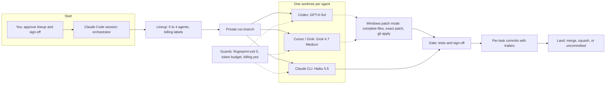

# Multi-model orchestrator architecture diagram

The diagram is also saved as [architecture.svg](architecture.svg) (1600x900, ink background, vellum text, Claude orange accent) for dropping onto a slide.

The SVG uses Inter, Segoe UI, sans-serif, as asked for this diagram. The deck type is still Big Shoulders, Instrument Serif, and IBM Plex, from `C:\VideoMaker\Decks\src\shell.html`.

<svg xmlns="http://www.w3.org/2000/svg" viewBox="0 0 1600 900" width="1600" height="900" font-family="Inter, Segoe UI, sans-serif">
  <title>Multi-model orchestrator architecture</title>
  <defs>
    <marker id="ar" viewBox="0 0 10 10" refX="9" refY="5" markerWidth="9" markerHeight="9" orient="auto-start-reverse">
      <path d="M0,0 L10,5 L0,10 z" fill="#EE8558"/>
    </marker>
    <marker id="ad" viewBox="0 0 10 10" refX="9" refY="5" markerWidth="9" markerHeight="9" orient="auto-start-reverse">
      <path d="M0,0 L10,5 L0,10 z" fill="#7C8393"/>
    </marker>
  </defs>
  <rect width="1600" height="900" fill="#0A0C10"/>
  <g font-size="14" fill="#7C8393" letter-spacing="1.5">
    <text x="40" y="44">YOU AND CLAUDE</text>
    <text x="344" y="44">LINEUP</text>
    <text x="908" y="44">RUN BRANCH</text>
    <text x="1190" y="44">SIDE PATHS</text>
  </g>
  <rect x="40" y="56" width="280" height="250" rx="14" fill="#141821" stroke="#262C38" stroke-width="2"/>
  <text x="64" y="104" font-size="26" font-weight="600" fill="#EDE6D8">You</text>
  <text x="64" y="140" font-size="16" fill="#B3AEA4">Approve the lineup</text>
  <text x="64" y="166" font-size="16" fill="#B3AEA4">Pick who signs off</text>
  <text x="64" y="210" font-size="24" font-weight="600" fill="#EDE6D8">Claude Code</text>
  <text x="64" y="244" font-size="16" fill="#B3AEA4">Orchestrates the run</text>
  <text x="64" y="270" font-size="16" fill="#B3AEA4">Splits the plan</text>
  <rect x="344" y="56" width="540" height="250" rx="18" fill="#0E1118" stroke="#EE8558" stroke-width="3"/>
  <text x="368" y="100" font-size="24" font-weight="600" fill="#EE8558">Lineup menu</text>
  <text x="368" y="140" font-size="18" fill="#EDE6D8">0 to 4 agents, one model each</text>
  <text x="368" y="170" font-size="18" fill="#B3AEA4">light, standard, or heavy</text>
  <text x="368" y="204" font-size="17" fill="#B3AEA4">uses your ChatGPT plan</text>
  <text x="368" y="232" font-size="16" fill="#B3AEA4">uses your Claude limits (same budget as this session)</text>
  <text x="368" y="260" font-size="17" fill="#B3AEA4">API costs will apply: explicit yes</text>
  <text x="368" y="286" font-size="16" fill="#7C8393">You approve before anyone starts</text>
  <rect x="908" y="56" width="252" height="250" rx="14" fill="#141821" stroke="#262C38" stroke-width="2"/>
  <text x="928" y="120" font-size="24" font-weight="600" fill="#EDE6D8">Run branch</text>
  <text x="928" y="164" font-size="16" fill="#B3AEA4">A private branch</text>
  <text x="928" y="192" font-size="16" fill="#B3AEA4">Off your folder</text>
  <text x="928" y="220" font-size="16" fill="#B3AEA4">Until you land</text>
  <text x="928" y="256" font-size="16" fill="#B3AEA4">Your checkout stays put</text>
  <rect x="40" y="334" width="1120" height="200" rx="18" fill="#0E1118" stroke="#EE8558" stroke-width="3"/>
  <text x="64" y="362" font-size="16" font-weight="600" fill="#EE8558">One git worktree per agent</text>
  <rect x="60" y="380" width="349" height="132" rx="12" fill="#141821" stroke="#262C38" stroke-width="2"/>
  <text x="84" y="418" font-size="22" font-weight="600" fill="#EDE6D8">Codex</text>
  <text x="84" y="450" font-size="18" fill="#B3AEA4">GPT-6-Sol</text>
  <text x="84" y="478" font-size="16" fill="#B3AEA4">Own git worktree</text>
  <rect x="425" y="380" width="349" height="132" rx="12" fill="#141821" stroke="#262C38" stroke-width="2"/>
  <text x="449" y="418" font-size="22" font-weight="600" fill="#EDE6D8">Cursor / Grok</text>
  <text x="449" y="450" font-size="18" fill="#B3AEA4">Grok 4.7 Medium</text>
  <text x="449" y="478" font-size="16" fill="#B3AEA4">Own git worktree</text>
  <rect x="790" y="380" width="349" height="132" rx="12" fill="#141821" stroke="#262C38" stroke-width="2"/>
  <text x="814" y="418" font-size="22" font-weight="600" fill="#EDE6D8">Claude CLI Haiku</text>
  <text x="814" y="450" font-size="18" fill="#B3AEA4">Haiku 5.5</text>
  <text x="814" y="478" font-size="16" fill="#B3AEA4">Own git worktree</text>
  <rect x="40" y="562" width="360" height="130" rx="14" fill="#141821" stroke="#262C38" stroke-width="2"/>
  <text x="64" y="600" font-size="22" font-weight="600" fill="#EDE6D8">Gate</text>
  <text x="64" y="630" font-size="16" fill="#B3AEA4">Tests, then sign-off</text>
  <text x="64" y="654" font-size="16" fill="#B3AEA4">This session, or other models</text>
  <rect x="420" y="562" width="360" height="130" rx="14" fill="#141821" stroke="#262C38" stroke-width="2"/>
  <text x="444" y="600" font-size="22" font-weight="600" fill="#EDE6D8">Per-task commits</text>
  <text x="444" y="630" font-size="16" fill="#B3AEA4">Implemented-by, Worker-session</text>
  <text x="444" y="654" font-size="16" fill="#B3AEA4">Reviewed-by, Fix-rounds, Tests</text>
  <rect x="800" y="562" width="360" height="130" rx="14" fill="#141821" stroke="#262C38" stroke-width="2"/>
  <text x="824" y="600" font-size="22" font-weight="600" fill="#EDE6D8">Land on your branch</text>
  <text x="824" y="630" font-size="16" fill="#B3AEA4">Merge, squash, or uncommitted</text>
  <text x="824" y="654" font-size="16" fill="#B3AEA4">Refuses staged, branch, or edit</text>
  <rect x="1190" y="56" width="370" height="272" rx="18" fill="#141821" stroke="#7C8393" stroke-width="3"/>
  <text x="1214" y="96" font-size="24" font-weight="600" fill="#EDE6D8">Guards</text>
  <text x="1214" y="132" font-size="18" font-weight="600" fill="#EDE6D8">Repo fingerprint</text>
  <text x="1214" y="156" font-size="16" fill="#B3AEA4">Status, diff, and untracked</text>
  <text x="1214" y="180" font-size="16" fill="#FF6B6B">Exit 5 on an outside change</text>
  <text x="1214" y="210" font-size="18" font-weight="600" fill="#EDE6D8">Token budget</text>
  <text x="1214" y="234" font-size="16" fill="#B3AEA4">Light 150k, standard 400k, heavy 1M</text>
  <text x="1214" y="258" font-size="16" fill="#B3AEA4">Not run again until you decide</text>
  <text x="1214" y="286" font-size="16" fill="#B3AEA4">API-key models need an explicit yes</text>
  <rect x="1190" y="344" width="370" height="506" rx="18" fill="#141821" stroke="#7C8393" stroke-width="3"/>
  <text x="1214" y="380" font-size="22" font-weight="600" fill="#EDE6D8">Patch mode on Windows</text>
  <rect x="1210" y="404" width="330" height="100" rx="12" fill="#0E1118" stroke="#262C38" stroke-width="2"/>
  <text x="1230" y="444" font-size="18" font-weight="600" fill="#EDE6D8">Read-only worker</text>
  <text x="1230" y="472" font-size="16" fill="#B3AEA4">Codex and Cursor</text>
  <rect x="1210" y="516" width="330" height="100" rx="12" fill="#0E1118" stroke="#262C38" stroke-width="2"/>
  <text x="1230" y="556" font-size="18" font-weight="600" fill="#EDE6D8">Complete files</text>
  <text x="1230" y="584" font-size="16" fill="#B3AEA4">Between random-code markers</text>
  <rect x="1210" y="628" width="330" height="100" rx="12" fill="#0E1118" stroke="#262C38" stroke-width="2"/>
  <text x="1230" y="668" font-size="18" font-weight="600" fill="#EDE6D8">Exact patch</text>
  <text x="1230" y="696" font-size="16" fill="#B3AEA4">Script builds it</text>
  <rect x="1210" y="740" width="330" height="100" rx="12" fill="#0E1118" stroke="#262C38" stroke-width="2"/>
  <text x="1230" y="780" font-size="18" font-weight="600" fill="#EDE6D8">git apply checks</text>
  <text x="1230" y="808" font-size="16" fill="#B3AEA4">Paths and symlink rollback</text>
  <path d="M320 181 L344 181" stroke="#EE8558" stroke-width="3" fill="none" marker-end="url(#ar)"/>
  <path d="M884 181 L908 181" stroke="#EE8558" stroke-width="3" fill="none" marker-end="url(#ar)"/>
  <path d="M1034 306 L1034 320 L600 320 L600 334" stroke="#EE8558" stroke-width="3" fill="none" marker-end="url(#ar)"/>
  <path d="M220 534 L220 562" stroke="#EE8558" stroke-width="3" fill="none" marker-end="url(#ar)"/>
  <path d="M400 627 L420 627" stroke="#EE8558" stroke-width="3" fill="none" marker-end="url(#ar)"/>
  <path d="M780 627 L800 627" stroke="#EE8558" stroke-width="3" fill="none" marker-end="url(#ar)"/>
  <path d="M1160 181 L1190 181" stroke="#7C8393" stroke-width="3" fill="none" marker-end="url(#ad)"/>
  <path d="M1160 434 L1190 434" stroke="#7C8393" stroke-width="3" fill="none" marker-end="url(#ad)"/>
  <text x="40" y="888" font-size="15" fill="#7C8393">Accent arrow: path of one task.    Slate arrow: guards, and Windows patch mode.    Red: fingerprint stop (exit 5).</text>
</svg>

## Path of one task

1. I approve a lineup in this Claude Code session: 0 to 4 agents, a model each, and who signs off.
2. Every model row shows where it comes from and how it is paid. API-key models do not run until I say yes.
3. Claude opens a private run branch. My own folder is not the workplace.
4. Each agent gets a git worktree. On the first run those were Codex (GPT-6-Sol), Cursor with Grok 4.7 Medium, and Claude CLI with Haiku 5.5. Two of the three ran at the same time.
5. On Windows, Codex and Cursor stay read-only and return complete files between random-code markers. A script builds an exact patch, and git apply checks it (paths, git's own checks, NTFS/HFS protection, symlink check with rollback) before anything is written.
6. Before and after every worker call, a fingerprint of my repo (status, diff, and untracked content) is compared. Any change outside the worktree stops the run with exit 5.
7. A token budget can stop a rerun until I decide: light 150k, standard 400k, heavy 1M.
8. Claude runs the tests and someone signs off ("This Claude session" or "Other models: I'm close to my Claude limit"). Each task is committed on the run branch with trailers: Implemented-by, Worker-session, Reviewed-by, Fix-rounds, Tests.
9. Land puts the run on my branch by merge, squash, or leaving it uncommitted. Land refuses if I have staged changes, if I switched branch, or if I edited a file the run changed.

## Notes for the slide

- Read left to right on the top row (you and Claude, the lineup, the run branch), then down into the worktrees, then left to right again: gate, per-task commits, land.
- The accent #EE8558 is the path of one task, and the stroke on the lineup and the worktree group. Slate arrows are the side paths: guards on every worker call, and Windows patch mode. Red appears once, on exit 5.
- Inner cards use the panel fill. The lineup and the worktree group use a darker fill and the accent stroke so they read as the choice and the workplace.
- Patch mode is Codex and Cursor on Windows. Haiku on the Claude CLI is not drawn through that box. The full patch checks (NTFS/HFS, git's own checks) are in the path above. The box keeps the four steps: read-only worker, complete files, exact patch, git apply checks.
- "Refuses staged, branch, or edit" is the short label for: staged changes, a switched branch, or an edit of a file the run changed.
- Copilot, Gemini, and macOS/Linux are untested, so they are not drawn. Nothing on this diagram is dashed, because every box is a path that already ran or already guards a run.

## Mermaid source

